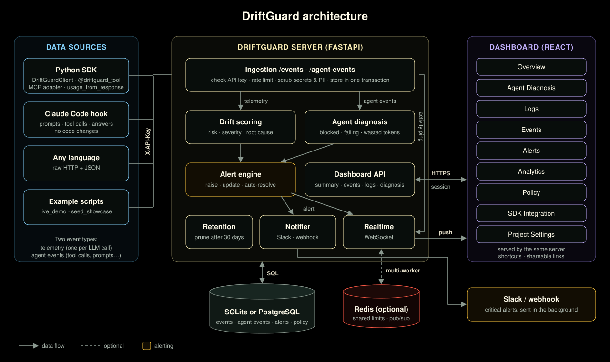

# DriftGuard documentation

New here? Read [How DriftGuard works](concepts.md), then
[Getting started](quickstart.md).

**Using DriftGuard**
- [Team setup](../SETUP.md): from a fresh laptop to a running DriftGuard, step by step
- [Getting started](quickstart.md): run it (one click, from source, or Docker), send data, troubleshooting
- [How DriftGuard works](concepts.md): the problem, the data, scoring and diagnosis in plain language
- [Dashboard guide](dashboard.md): every view, card and column, with screenshots
- [Measuring retrieval score and response quality](scoring-guide.md): how to calculate the two scores, what to do without an evaluator, choosing floors, and what the numbers can't tell you
- [Agent integration](agent-integration.md): instrument an agent's tools (decorator, MCP, HTTP, Claude Code)
- [Claude Code hook](../integrations/claude_code/README.md): report Claude Code sessions with no code
- [Giving a demo](demo.md): a live demo, a presentation outline, talking points
- [API reference](api.md): HTTP endpoints

**Running DriftGuard**
- [Configuration](configuration.md): environment variables and policy
- [Deployment](deployment.md): Docker, TLS, scaling, backups, upgrades

**Working on DriftGuard**
- [Architecture](architecture.md): diagrams, request flows, algorithms, data model, security
- [Development](development.md): setup, tests, CI, releases
- [Design system](design-system.md): the dashboard's signal box look
- [Product context](PRODUCT.md): users, purpose, positioning and constraints
- [DESIGN.md](../DESIGN.md): the design tokens and components, written from the built code
- [Research](../research/README.md): the simulation study of floors against the baseline comparison, and the Phase 1 prototypes
- [Roadmap](roadmap.md): status and next steps
- [Progress report](progress.md): what's done, what changed, and what's next
- [Changelog](../CHANGELOG.md)

The diagram source is [images/architecture.svg](images/architecture.svg). A PNG
for slides is at [images/architecture.png](images/architecture.png).
